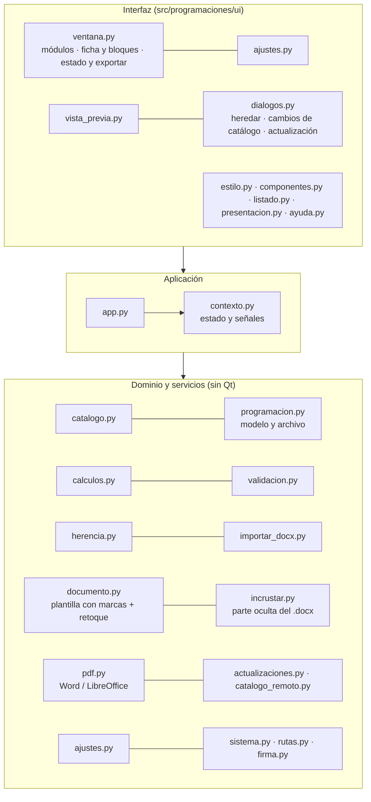

# TRD · Programaciones

Documento de requisitos técnicos. Versión inicial: 2026-10-14. Qué hace la app: [PRD.md](PRD.md). Por qué se ha decidido así: [docs/DECISIONES.md](docs/DECISIONES.md).

## 1. Stack

| Pieza | Elección | Motivo |
| --- | --- | --- |
| Lenguaje | Python 3.11 | El mismo que Partes de salida y Guardias de patio, y que los scripts de currículo que ya existen (`curriculo.py`, `vigilancia.py`) |
| Interfaz | PyQt6 6.7 | Las mismas versiones que Partes de salida, para reutilizar `ui/` tal cual |
| Documento | Motor propio con `lxml` sobre la plantilla con marcas, desempaquetada en el repositorio (ADR-019; antes se preveía `docxtpl`) | Conserva encabezado, pie, estilos, franja vertical e índice de la plantilla del departamento, sin dependencias nuevas |
| PDF | Word del equipo (AppleScript en macOS, COM por PowerShell en Windows); si no hay Word, LibreOffice sin interfaz, con un perfil temporal y el índice numerado con las páginas del PDF | Sin servidor: el equipo del profesor convierte. Si no hay ninguno, solo `.docx` y un aviso |
| Vista previa | `QtPdf` / `QPdfView` en una ventana propia | El mismo PDF que se exportará, con marca «BORRADOR» |
| Catálogo | YAML en el repositorio → JSON empaquetado en la app; firma Ed25519 (`cryptography`) | Auditable en git y verificable al descargar |
| Datos del profesor | Archivo `.programacion` (JSON) + copia incrustada en el `.docx` exportado | Sin base de datos ni servidor (ADR-002) |
| Validación | `jsonschema` sobre el archivo de trabajo y el catálogo | Un archivo corrupto o de otra versión se detecta al abrirlo |
| Empaquetado | PyInstaller `onedir`, DMG en macOS, Inno Setup en Windows (instalador y portable) | Lo mismo que Partes de salida |
| Calidad | ruff (120 columnas), pytest, pytest-qt (`offscreen`) | Lo mismo que Partes de salida |

## 2. Lo que se reutiliza de Partes de salida

Se copia y se adapta (no se reescribe). Cada pieza mantiene el mismo comportamiento y documentación.

| Pieza de Partes de salida | Uso en Programaciones | Cambio |
| --- | --- | --- |
| `actualizaciones.py` (API de GitHub con plan B por la web, hosts permitidos, `certifi`, instalador por sistema) | Aviso de versión nueva de la app | `REPO = "cferrerobonet/programaciones_fp"` y nombres de instalador propios |
| `ui/dialogos.py` → `DialogoActualizacion`, `_Descargador`, `buscar_actualizaciones`, `_Puente` | **Ventana de novedades** (círculo dorado, novedades en Markdown, «Más tarde» / «Actualizar ahora»), descarga e instalación | Ninguno. Se usa el mismo diálogo para los cambios del catálogo (§6) |
| `CHANGELOG.md` → notas del release (`awk` en `compilar.yml`) | Las novedades que ve el profesor son la entrada de la versión en `CHANGELOG.md` | Ninguno |
| `.github/workflows/compilar.yml` y `comprobar.yml` | **Cada versión se compila en GitHub, nunca en local** (requisito de CarlosFB). Etiqueta `vX.Y.Z` → compila macOS y Windows, arranca la app compilada y adjunta DMG, instalador y portable al release. También se puede lanzar a mano desde la pestaña Actions («Compilar» → *Run workflow*), con las mismas opciones que en Partes de salida. Lint y tests en cada push | Nombres |
| `PartesSalida.spec`, `installer_windows.iss`, `scripts/build/` (`build_dmg.sh`, `crear_icono.sh`), `build_windows.ps1`, `prueba_arranque_windows.ps1` | Empaquetado | Nombres e icono. La plantilla `.docx` y el catálogo van como datos del paquete |
| `app.py`: instancia única (`QLocalServer`) y prueba de arranque de la CI | Arranque | Sin icono en la bandeja ni arranque con la sesión |
| `sistema.py`: registro rotatorio y `faulthandler` | Diagnóstico | Sin `arranque_con_sistema` |
| `rutas.py` | Carpeta de datos y recursos, también en la app congelada | Variable `PROGRAMACIONES_DATOS` para los tests |
| `ajustes.py` (JSON con valores por defecto, exportar e importar) | Ajustes del profesor | Campos propios (§7). **Los campos del correo, vacíos:** el original lleva servidor, puerto y buzón escritos y no se copian (ADR-016) |
| `firma.py` (Ed25519) | Verificar la firma del catálogo descargado | Solo verificación. La clave privada está en un secreto de GitHub |
| `ui/estilo.py`, `ui/componentes.py` (`etiqueta`, `boton`, `FlujoLayout`, `AvisoFlotante`, `ZonaSoltar`, `Tarea`), `ui/listado.py` (`TablaPaginada`), `ui/presentacion.py`, `ui/ayuda.py`, fuentes y logos | Toda la interfaz (ver [DESIGN.md](DESIGN.md)) | Textos. `ayuda.py` explica cómo añadir la carpeta de Teams a OneDrive |
| `scripts/qa.sh`, `Makefile` (`venv`, `ganchos`, `run`, `capturas`), `scripts/capturas.py` | Comprobaciones y capturas | Rutas |
| `.githooks/pre-commit` | Repositorio público: bloquea datos, binarios, secretos y la palabra prohibida | Se permiten la plantilla `.docx` en `src/programaciones/recursos/plantilla/` y los `.docx` de prueba ficticios en `tests/datos/` |
| `.claude/hooks/guardia_bash.sh` y `tras_editar.sh` | Bloquea `git add -A`, `--amend`, push forzado, `--no-verify`, la coautoría, compilar en local y `ssh`/`sftp`/`scp` | Ninguno |
| `.claude/rules/`, skills `publicar` y `tests`, agentes `revisor` y `verificador` | Forma de trabajar | Adaptadas al proyecto |
| `.github/ISSUE_TEMPLATE/`, `pull_request_template.md`, `CONTRIBUTING.md` | Flujo de trabajo | Nombres |
| `correo.py` y `ui/envios.py` de Partes de salida (SMTP) | — | **No se copian:** ADR-014 eligió la opción A, un borrador en el programa de correo del profesor. `correo.py` de Programaciones es propio (Mail y Outlook por AppleScript, Outlook clásico por COM, `.eml` y `mailto:`) |

**No se reutilizan** `cifrado.py`, `impresion.py`, el llavero ni los importadores de Educamos: aquí no hay datos del alumnado, impresión directa ni contraseñas (ADR-014).

## 3. Arquitectura

Monolito de escritorio en tres capas, con las dependencias hacia abajo, igual que Partes de salida:



| Módulo | Responsabilidad |
| --- | --- |
| `catalogo.py` | Lee el catálogo (hoy, el YAML del repositorio; con F5, el empaquetado o el descargado más reciente que tenga la firma válida). Ficha de cada módulo con los textos corregidos y el nombre del Decreto 95/2026, normativa por ciclo y curso y diferencias entre dos versiones del catálogo |
| `programacion.py` | La programación como diccionario con esquema JSON (ver [docs/MODELO_DE_DATOS.md](docs/MODELO_DE_DATOS.md)), lectura, validación y escritura atómica del `.programacion`, huella canónica y migraciones de formato |
| `calculos.py` | Pesos, reparto de horas por RA, tabla 4.1, modalidad de cada RA y porcentajes (RF-04). Puro y con muchos tests |
| `validacion.py` | Reglas V-xx (ver [docs/DOCUMENTO_GENERADO.md](docs/DOCUMENTO_GENERADO.md#validaciones)). Devuelve avisos con gravedad: los que bloquean la definitiva y los que solo informan |
| `herencia.py` | «Nueva a partir de…»: lee el `.docx` (con datos incrustados o una programación antigua) o el `.programacion`, copia los bloques manuales marcados como heredados con el catálogo, la plantilla y el curso escolar de ahora y quita y señala los RA que ya no existen |
| `almacen.py` | Archivo de trabajo de cada programación en la carpeta de datos (`programaciones/<curso>/`), las 10 últimas copias en `autoguardado/` y el estado de cada paso y de la programación (vacío · heredado · confirmado; en curso · exportada) |
| `exportacion.py` | El trabajo de «Exportar» y de la vista previa, en una `Tarea`: rellenar, incrustar, comprobar con las reglas de la skill y escribir el `.docx` y el `.pdf` con el nombre normalizado |
| `importar_docx.py` | Recupera los datos incrustados o, si no los hay, lee una vez la programación `.docx` con la estructura de la plantilla: profesorado, tablas 3, 4 y 4.1, párrafos propios y textos propios |
| `documento.py` | Rellena la plantilla y aplica el retoque: hipervínculos de la normativa (también en los párrafos del profesor), índice (`updateFields`), `keepNext` en los títulos, numeraciones reiniciadas y marca «BORRADOR» en la vista previa |
| `contenido.py` | El cuerpo de un .docx por apartados, la comparación de contenido entre dos programaciones, el texto que firma la huella y la verificación de la skill `programacion-didactica` |
| `ooxml.py` | Utilidades del paquete de Word (partes, relaciones, tipos, orden de los elementos) |
| `incrustar.py` | Escribe y lee la parte XML personalizada con el JSON de la programación y sus huellas |
| `pdf.py` | Convierte con Word o LibreOffice en un hilo, con tiempo máximo y error claro |
| `correo.py` | Borrador del correo con los adjuntos en el programa de correo del profesor (ADR-014): plantilla del asunto y del cuerpo, tamaño, programa por defecto y, por plataforma, Mail u Outlook (AppleScript), Outlook clásico (COM), `.eml` con `X-Unsent: 1` y la reserva `mailto:`. Las órdenes externas pasan por `_ejecutar` y `_abrir`, que las pruebas simulan |
| `catalogo_remoto.py` | Descarga y verifica el catálogo publicado (§6) |
| `ajustes.py` · `actualizaciones.py` · `rutas.py` · `sistema.py` | Ajustes del equipo (§7), aviso de versión nueva, carpeta de datos y recursos (también en la app congelada) y registro: copias adaptadas de Partes de salida |
| `diagnostico.py` | Lee lo que la app lleva dentro (catálogo, esquemas, plantilla, tipografías) para la prueba de arranque de la app compilada |
| `contexto.py` (con Qt) | Estado compartido: ajustes, catálogo, curso escolar, lista de módulos y programación abierta, con sus señales. Cada cambio del profesor pasa por `cambiar` (confirma el paso y guarda solo) |
| `ui/` | `ventana.py` (barra, menú, abrir, vista previa y exportar), `columnas.py` (las tres zonas), `bloques.py` (los cinco bloques del profesor), `modales.py` (exportando, cambios de currículo, modificado en Word, primer arranque y detalle del currículo), `ajustes.py`, `programaciones.py` (listado con sus acciones y «Nueva a partir de…»), `gestion.py` (vista previa, exportar a carpeta, enviar por correo y borrar sobre una o varias, en `Tarea`), `correo.py` (ventana «Enviar por correo»), `vista_previa.py` (QtPdf), `dialogos.py` (novedades y actualización) y las piezas comunes copiadas de Partes de salida |

## 4. Requisitos no funcionales

| ID | Requisito |
| --- | --- |
| RNF-01 | Arranque en menos de 3 s en un equipo del centro, sin esperar a la red. Las comprobaciones de actualización van en un hilo |
| RNF-02 | Funciona sin conexión con el último catálogo válido |
| RNF-03 | La interfaz nunca se bloquea: generar el documento, el PDF y las descargas van en `Tarea` (QThread) con barra de progreso |
| RNF-04 | `.docx` en menos de 3 s. PDF en menos de 30 s con Word y con un tiempo máximo de 120 s |
| RNF-05 | Autoguardado del archivo de trabajo al cambiar de bloque y cada minuto, con escritura atómica y las 10 últimas versiones en la carpeta de datos |
| RNF-06 | Las mismas versiones de macOS y Windows que Partes de salida. En Windows, versión portable para equipos sin permiso de instalación |
| RNF-07 | Registro rotatorio en la carpeta de datos. Sin telemetría |
| RNF-08 | El formato del `.programacion` y de la parte incrustada lleva versión. Un cambio incompatible sube la versión mayor y trae su migración |
| RNF-09 | Repositorio público: ningún dato personal, contraseña ni clave privada (gancho `pre-commit` y test) |

## 5. Almacenamiento en el equipo

```
<carpeta de datos>/                 macOS: ~/Library/Application Support/Programaciones
├── ajustes.json                    Windows: %APPDATA%\Programaciones
├── catalogo/                       último catálogo descargado y verificado (+ firma), con F5
├── programaciones/<curso>/         el .programacion de cada módulo (SIGLA-curso-código), guardado solo
├── autoguardado/<curso>-<id>/      10 últimas versiones de cada programación
└── logs/app_AAAAMMDD.log · faulthandler.log
```

La app guarda sola el archivo de trabajo de cada programación en la carpeta de datos (al cambiar algo y con ⌘S); «Abrir…» lee un `.programacion` o un `.docx` de cualquier sitio. Los exportados (`.docx`, `.pdf`) van a la carpeta de entrega del curso (Ajustes) o a la que elija el profesor: lo recomendable es la carpeta de Teams sincronizada con OneDrive. La carpeta de datos solo sirve para comodidad y recuperación rápida. Lo que no se puede perder viaja en el `.docx` exportado (ADR-002).

## 6. Actualizaciones

| Qué | Canal | Comportamiento |
| --- | --- | --- |
| **App** | Releases `vX.Y.Z` de `cferrerobonet/programaciones_fp` (público), el mismo código que Partes de salida | Al arrancar y desde «Acerca de»: botón dorado «↑ Actualizar a X.Y.Z» en la barra y ventana de novedades con la entrada del `CHANGELOG.md` |
| **Catálogo** (ADR-005 y ADR-015) | `catalogo/publicado/` en la rama `main`, servido por `raw.githubusercontent.com` (se añade a `HOSTS_PERMITIDOS`), con `indice.json` + firma Ed25519 | Al arrancar, en un hilo: si hay versión nueva con la firma válida, se descarga sin reinstalar. No se aplica a ninguna programación por su cuenta: al abrir una de un módulo afectado, se enseña la **misma ventana de novedades** con sus cambios («RA3 de 0517: criterio nuevo…») y «Más tarde» / «Aceptar cambios». **Cada profesor aprueba** |

El catálogo no va en releases para que `releases/latest` siga apuntando siempre a la versión de la app. La app también trae un catálogo dentro, por si arranca sin conexión la primera vez.

**Vigía** (`.github/workflows/vigia.yml`, semanal): comprueba las fuentes oficiales, rehace los módulos afectados y abre una PR con las diferencias, que se fusiona sola si pasan las comprobaciones automáticas. Entonces `catalogo.yml` firma y publica. Detalle en [docs/CATALOGO_Y_FUENTES.md](docs/CATALOGO_Y_FUENTES.md).

## 7. Ajustes

| Ajuste | Valor por defecto |
| --- | --- |
| Nombre del profesor (para la portada) | Vacío: se pide la primera vez |
| Carpeta de entrega de cada curso escolar (ruta local sincronizada o enlace de Teams) | Vacío: se pide al empezar cada curso |
| Formatos al exportar | Word y PDF |
| Programa para el PDF | Automático (Word → LibreOffice) |
| Correo del departamento para el pie del documento (ADR-018, decisión 11) | Vacío: el pie sale sin correo |
| Destinatarios habituales del correo, programa de correo y plantilla del asunto y del cuerpo (ADR-014) | Sin destinatarios · «Automático» · las plantillas de la app |
| Módulos favoritos (`EntradaModulo.clave`) | Ninguno |

## 8. Calidad

Estrategia completa: [docs/PLAN_DE_PRUEBAS.md](docs/PLAN_DE_PRUEBAS.md). El criterio de salida de la primera versión es que la app **regenere las seis programaciones de 2026-2027** desde sus datos sin diferencias de contenido y que el `verificar.py` de la skill `programacion-didactica` no dé avisos.
