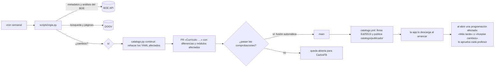

# Catálogo y fuentes oficiales

Cómo se construye y cómo se mantiene al día el catálogo curricular. Estructura de los archivos: [MODELO_DE_DATOS.md](MODELO_DE_DATOS.md). Decisiones: ADR-005, ADR-015 (cada profesor aprueba los cambios) y ADR-017 (reglas de lectura).

## 1. Fuentes de cada dato

| Dato | Fuente | Cómo se lee |
| --- | --- | --- |
| Ciclos del centro | Web Pedidos en producción (API pública de `dotacion_material`, `get_cursos` con `etapa_id=5` y `grado=GM/GS`) | Una sola vez: ADR-003. Consultado el 2026-10-14 |
| Módulos de cada ciclo, curso, h/semana y h/año | **Decreto 95/2026, anexo IV**, que da nueva redacción a los anexos I (GM) y II (GS) del Decreto 114/2025 (DOGV núm. 10391, 2026-06-25). Su corrección de errores (2026-06-29) no toca los horarios | PDF del DOGV con `pdftotext -layout`. Cada curso tiene que sumar los totales del propio decreto (30 h y 1.000 h) |
| RA, criterios, competencias del módulo (orientaciones pedagógicas), competencia general (art. 4), competencias (art. 5) y anexo V B) de los módulos propios | Real decreto de cada título, en su redacción vigente | XML del diario del BOE (`/diario_boe/xml.php?id=…`). **Ningún real decreto de título está consolidado en el BOE:** se lee el original y, encima, lo que reescriben las normas que lo modifican (§5) |
| UC → ECP | RD 532/2025 (BOE-A-2025-13147), anexo I: código y denominación de cada ECP; y sus tablas de UC suprimidas con su ECP equivalente | XML del BOE |
| RA de los módulos comunes (0156, 0179, 1709, 1710, 1664, 1665, 1708) | Anexos III a IX del Decreto 114/2025 (el currículo valenciano: RD 659/2023 con las concreciones del art. 3) | PDF del DOGV |
| RA de los módulos autonómicos CV0014 y CV0015 (Profundización en inglés profesional, en 1.º de GA y de ADM) | Anexo XII del Decreto 114/2025, que añade el anexo V del Decreto 95/2026 | PDF del DOGV |
| RA de los optativos que oferta el centro | Anexo X del Decreto 114/2025: X-I (Inglés oral) y X-IX (Electricidad y Electrónica) | PDF del DOGV |
| Optativos que oferta el centro | Programaciones de SEA, STI y ARI (2.2): 0179 Inglés oral (confirmado por CarlosFB el 2026-10-14), CVOPS031 (IA) y CVOPS141 (fotovoltaica). El decreto no da código a los optativos: es el del centro | A mano. El resto de ciclos, pendiente de CarlosFB |
| RA del Proyecto intermodular de GM (`1713xxx`) | **Pendiente de localizar** | — |
| Normativa general y autonómica (apartados 1.1 y 1.2) | BOE y DOGV, con los enlaces ya verificados en las programaciones de referencia | Título oficial: metadatos del BOE o primera página del PDF del DOGV |
| Resolución de instrucciones de FP de cada curso | DOGV, cada julio | Aviso del vigía en julio y alta a mano |
| Fechas de evaluación y periodos de empresa | Calendario escolar FP y calendario de FE del centro (notas de la bóveda en `02 CURSOS ESCOLARES/<curso>/`) | A mano, una vez por curso (`cursos/`, aún sin crear: faltan los datos de GM y de 1.º) |

**Regla:** si un dato no está en la fuente, o la fuente es ambigua, no se pone. El elemento lleva `pendiente` con su motivo, la app lo enseña como «sin dato» y bloquea la definitiva de ese módulo, y la duda va a [PENDIENTE.md](PENDIENTE.md).

**Huellas:** `catalogo/fuentes.yaml` guarda cada documento leído con su URL, su enlace, la fecha de publicación, la de consulta y la huella SHA-256 del archivo descargado. Cada módulo guarda además la huella de su propio bloque de texto, para que el vigía sepa qué módulo ha cambiado.

## 2. Vigía (`.github/workflows/vigia.yml`, fase F5)



- **Base:** `vigilancia.py` de la guía `apuntes-auditoria`, que ya guarda el estado conocido de cada norma, detecta cambios y acepta revisiones con `--aceptar`.
- **Qué compara:**
  - BOE: las referencias posteriores de cada real decreto (que no tienen texto consolidado) y la huella de su XML.
  - DOGV: la huella de los PDF de `fuentes.yaml` y la página de normativa de la Conselleria, que enlaza las normas nuevas (así se encontró el Decreto 95/2026).
- **Cuando hay un cambio,** la PR lleva tres cosas:
  - Qué norma ha cambiado y su enlace.
  - Las diferencias legibles («RA3 de 0517: criterio *g* nuevo…»).
  - El texto de novedades que verá el profesor.
- **En julio** abre además una incidencia: «Dar de alta el curso AAAA-AAAA: resolución de instrucciones, fechas, FE».
- **Si una fuente no responde,** la ejecución falla con aviso y no toca el catálogo.

## 3. Publicación y firma (fase F5)

- La clave privada Ed25519 está solo en un secreto del repositorio (`CATALOGO_CLAVE`). La pública va dentro de la app.
- `indice.json` contiene la versión (`AAAA.MM.DD[.n]`), la fecha, la huella SHA-256 del catálogo, la firma y las novedades en Markdown, por módulo afectado.
- La app solo acepta un catálogo con la firma válida y una versión mayor que la que tiene. Si algo falla, sigue con el anterior y lo apunta en el registro.

## 4. Construcción (`scripts/catalogo.py`)

```bash
PY=~/.venvs/programaciones/bin/python
$PY scripts/catalogo.py construir todo        # o una sigla: SEA, STI, ARI, IEA, IT, GA, ADM, ISO, AUT, CAR, EMV
$PY scripts/catalogo.py construir SEA --sin-red   # solo con los documentos ya descargados
$PY scripts/catalogo.py comprobar [--red]     # esquemas, horas, RA, fuentes y huellas; --red: enlaces vivos
$PY scripts/catalogo.py comparar <programación.docx>…   # RA y criterios del apartado 11 frente al catálogo
```

- **Receta** en el propio script: real decreto de cada título, normas que reescriben módulos o el anexo V, anexo del DOGV de cada módulo común y optativos del centro. Lo demás se lee de la fuente.
- **Caché** de los documentos fuera de iCloud (`~/Library/Caches/programaciones/fuentes`). Necesita `pdftotext` (poppler) para los PDF del DOGV.
- **Siempre se rehace todo en memoria**, porque un módulo puede estar en dos ciclos. Con una sigla, solo se escriben su ciclo y sus módulos. Los archivos que no cambian no se reescriben.
- **Cierre de un cambio:**
  - `comprobar` limpio.
  - `pytest`.
  - En local, `-m referencias`: los RA de las seis programaciones de referencia (0517, 0524, 0525, 0526, 0962 y 0963), idénticos.
- **F1 cerrada el 2026-10-17:** los 11 ciclos con sus módulos y horas, y los RA de todos los módulos propios, comunes y optativos ofertados. Fuera, como pendiente: el Proyecto intermodular de GM y los optativos de GM y de las familias que no son de Electricidad.

## 5. Reglas de lectura (ADR-017)

| Caso | Regla |
| --- | --- |
| Normas que modifican el título | Se leen sus referencias posteriores en el BOE y cada una se revisa a mano una vez. **RD 401/2023** reescribe los módulos 0959-0968 de ARI y el anexo V de SEA. **RD 289/2023** reescribe el art. 4 y siete módulos de ISO. **RD 499/2024** sustituye el anexo V de GA, IEA y EMV. RD 499/2024 y RD 500/2024 quitan además FOL, EIE y FCT, añaden los módulos comunes y llaman «Proyecto intermodular» al proyecto, sin cambiar los RA de los módulos propios. RD 1126/2010 solo cambia el código de Inglés de GA. RD 1085/2020 deroga el anexo de convalidaciones |
| Texto | Literal, también con erratas del BOE: se normalizan solo los espacios |
| Numeración con erratas | `n` y `letra` son la posición. Si el BOE imprime otra cosa, se guarda en `n_boe` o `letra_boe` (un «2.» repetido en 0292, «ñ)» en 0558, «j)» sin «i)» en 0453, «y)» en 1708) |
| Criterios sin letra | En algunos BOE (RD 883/2011, RD 453/2010) los pinta la lista o un guion: se letran en orden, como `curriculo.py` |
| Párrafos juntos (BOE de 2008) | Se separan por número de RA o letra de criterio, solo si siguen la secuencia o tienen forma de RA o de criterio («Se ha…») |
| Competencias del módulo | Las letras de «… y las competencias a), b)… del título» de las orientaciones pedagógicas. «Todas las competencias» se expande con las del ciclo. El Proyecto no las cita: lista vacía |
| Competencias numeradas | GA e IT numeran el art. 5 (1., 2.…) y el anexo I las cita con letras: se guarda tal cual, con `pendiente_competencias` |
| Módulo en dos títulos | Un archivo si el texto es idéntico en los dos reales decretos. Si no, uno por título: 0237 y 0238 (IT e IEA) y 0260 (CAR y EMV) difieren en comas y palabras sueltas |
| Nombre del módulo | El del real decreto en `modulos/`, y el del Decreto 95/2026 en el ciclo. En el Proyecto, el del decreto. Las diferencias, en [PENDIENTE.md](PENDIENTE.md) |
| ECP | Código y denominación del anexo I del RD 532/2025. Una UC que no está allí queda con `codigo: null` y `pendiente` |
| Módulos comunes | El anexo del Decreto 114/2025, que amplía el RD 659/2023 (más RA en 1709 y 1710, criterios distintos): manda el currículo valenciano |
