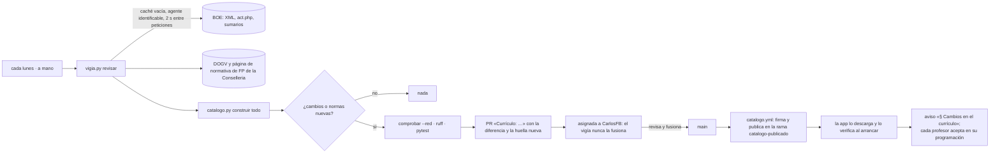

# Catálogo y fuentes oficiales

Cómo se construye y cómo se mantiene al día el catálogo curricular. Estructura de los archivos: [MODELO_DE_DATOS.md](MODELO_DE_DATOS.md). Decisiones: ADR-005, ADR-015 (cada profesor aprueba los cambios), ADR-017 (reglas de lectura), ADR-027 (publicación firmada) y ADR-028 (qué publica solo el vigía).

## 1. Fuentes de cada dato

| Dato | Fuente | Cómo se lee |
| --- | --- | --- |
| Ciclos del centro | Web Pedidos en producción (API pública de `dotacion_material`, `get_cursos` con `etapa_id=5` y `grado=GM/GS`) | Una sola vez: ADR-003. Consultado el 2026-10-14 |
| Módulos de cada ciclo, curso, h/semana y h/año | **Decreto 95/2026, anexo IV**, que da nueva redacción a los anexos I (GM) y II (GS) del Decreto 114/2025 (DOGV núm. 10391, 2026-06-25). Su corrección de errores (2026-06-29) no toca los horarios | PDF del DOGV con `pdftotext -layout`. Cada curso tiene que sumar los totales del propio decreto (30 h y 1.000 h) |
| RA, criterios, competencias del módulo (orientaciones pedagógicas), competencia general (art. 4), competencias (art. 5) y anexo V B) de los módulos propios | Real decreto de cada título, en su redacción vigente | XML del diario del BOE (`/diario_boe/xml.php?id=…`). **Ningún real decreto de título está consolidado en el BOE:** se lee el original y, encima, lo que reescriben las normas que lo modifican (§5) |
| UC → ECP | RD 532/2025 (BOE-A-2025-13147), anexo I: código y denominación de cada ECP; y sus tablas de UC suprimidas con su ECP equivalente | XML del BOE |
| RA de los módulos comunes (0156, 0179, 1709, 1710, 1664, 1665, 1708) | Anexos III a IX del Decreto 114/2025 (el currículo valenciano: RD 659/2023 con las concreciones del art. 3) | PDF del DOGV |
| RA de los módulos autonómicos CV0014 y CV0015 (Profundización en inglés profesional, en 1.º de GA y de ADM) | Anexo XII del Decreto 114/2025, que añade el anexo V del Decreto 95/2026 | PDF del DOGV |
| RA de los optativos que oferta el centro | Anexo X del Decreto 114/2025: X-I (Inglés oral) y X-IX (Electricidad y Electrónica) | PDF del DOGV |
| Optativos que oferta el centro | Programaciones de SEA, STI y ARI (2.2): 0179 Inglés oral (confirmado por CarlosFB el 2026-10-14), CVOPS031 (IA) y CVOPS141 (fotovoltaica). GM (IT, IEA, GA, CAR y EMV): ANEXO X-I, Inglés oral para entornos profesionales, en 2.º (CarlosFB, 2026-10-18). El decreto no da código a los optativos: es el del centro | A mano. ADM, ISO y AUT, pendientes de CarlosFB |
| RA del Proyecto intermodular de GM (`1713xxx`) | **Pendiente de localizar** | — |
| **Grado Básico** (ADR-032): ciclos del centro | Web de pedidos en producción (copia del 2026-10-10): EE, IC, MV y SA | Una vez, como ADR-003 |
| GB: título, competencia general, competencias, RA de los técnicos | RD 127/2014, un anexo por título (I SA, II EE, IV IC, VI MV), apartados 1, 2.1, 2.2 y 3.3; el RD 498/2024 lo actualiza sin cambiar esos RA | XML del BOE (`Boe.anexo`) |
| GB: correspondencias UC → módulo | RD 498/2024, «6 bis» de cada título (apartados Uno, Dos, Cuatro y Seis de su artículo) | `seis_bis` |
| GB: módulos, h/semana y h/año (con la tutoría) y materias de Comunicación y Ciencias Sociales | Decreto 117/2025, anexos III-A y III-B, en la redacción del anexo VI del Decreto 95/2026 | `horario_gb` y `materias_ccs` (PDF del DOGV) |
| GB: 3159 (9 RA) · 3160 (5 RA) · ámbitos 3161-3164 (CE, descriptores, criterios y saberes) | Decreto 117/2025, anexo I · RD 498/2024, anexo I · RD 217/2022, anexo V | `ra_dogv` · `modulos_boe` · `ambitos_boe` |
| Contenidos básicos por bloques (unidades propuestas de una programación nueva, ADR-031) | El mismo real decreto (o anexo del DOGV) que los RA | `leer_contenidos` (BOE: tres formatos) y `contenidos_dogv` (formato numerado). Solo si se leen con seguridad; si no, `contenidos_pendiente` |
| Propuesta de competencias de cada RA (ADR-031) | **No oficial:** propuesta de IA en `scripts/propuestas/ra_competencias.yaml`, con la huella de los RA de cada módulo | `anadir_propuestas`: entra si la huella coincide, están todos los RA y solo hay letras del módulo; si no, aviso y fuera |
| Normativa general y autonómica (apartados 1.1 y 1.2) | BOE y DOGV, con los enlaces ya verificados en las programaciones de referencia | Título oficial: metadatos del BOE o primera página del PDF del DOGV |
| Resolución de instrucciones de FP de cada curso | DOGV, cada julio | Incidencia del vigía en julio, agosto y septiembre y alta a mano |
| Fechas de evaluación y periodos de empresa | Calendario escolar FP y calendario de FE del centro (notas de la bóveda en `02 CURSOS ESCOLARES/<curso>/`) | A mano, una vez por curso (`cursos/`, aún sin crear: faltan los datos de GM y de 1.º) |

**Regla:** si un dato no está en la fuente, o la fuente es ambigua, no se pone. El elemento lleva `pendiente` con su motivo, la app lo enseña como «sin dato» y bloquea la definitiva de ese módulo, y la duda va a [PENDIENTE.md](PENDIENTE.md).

**Huellas:** `catalogo/fuentes.yaml` guarda cada documento leído con su URL, su enlace, la fecha de publicación, la de consulta y la huella SHA-256 del archivo descargado. Cada módulo guarda además la huella de su propio bloque de texto, para que el vigía sepa qué módulo ha cambiado.

## 2. Vigía (`.github/workflows/vigia.yml` y `scripts/vigia.py`, F5)



- **Base:** `vigilancia.py` de la guía `apuntes-auditoria` (estado conocido de cada fuente, punto de partida la primera vez, aviso de lo nuevo), con el lector del catálogo.
- **Qué revisa:**
  - Todas las fuentes de `fuentes.yaml`, descargadas de nuevo: si un documento cambia, `construir` lo vuelve a leer y la PR lleva su huella nueva y lo que cambia.
  - Referencias posteriores de cada real decreto (los títulos no están consolidados), que `construir` guarda en `ciclos/<SIGLA>.yaml`.
  - Texto consolidado de las normas generales que lo tienen (LOE, LO 3/2022, RD 659/2023): «Última actualización» de su página `act.php` y su vigencia.
  - Sumarios del BOE de los últimos 8 días: disposiciones que citan un real decreto del catálogo o disposiciones generales de FP del Ministerio (sin subvenciones, ayudas, becas ni convocatorias).
  - La página de normativa de FP de la Conselleria (así se encontró el Decreto 95/2026): citas de decretos, órdenes y resoluciones.
  - Lo ya visto queda en `catalogo/vigia.yaml` (no va en el paquete de la app).
- **Nada se publica solo** (ADR-028): toda PR del vigía la revisa y la fusiona CarlosFB, también la que solo cambia el texto de RA o criterios con todo en verde. «Revisar a mano» señala lo que pide más cuidado: PDF del DOGV (R2), horas, RA o criterios nuevos o quitados, normas nuevas, referencias posteriores, textos consolidados, sumarios, Conselleria y lo que no se ha sabido leer. **No inventa RA ni horas:** si no puede leer una fuente, el catálogo se queda como estaba.
- **La PR lleva:** la norma o el documento que cambia, con su enlace y la huella vieja y nueva; las diferencias legibles por módulo («RA3 de 0517: criterio b) cambia»), que son también el texto que verá el profesor; la lista «Revisar a mano»; y los archivos tocados. Los mismos cambios no abren otra PR.
- **En julio, agosto y septiembre** abre además una incidencia: «Dar de alta el curso AAAA-AAAA: resolución de instrucciones, fechas y FE».
- **Si una fuente del catálogo no responde** (BOE o DOGV), la ejecución falla con aviso y no toca el catálogo. Si la que no responde es la página de la Conselleria (auxiliar), tres intentos y, si no, un aviso en el resumen y en la PR; se vuelve a mirar la semana siguiente.
- **Simulacro:** `gh workflow run vigia.yml -f simulacro=true` hace un cambio ficticio en un criterio de 0517 y abre una PR en borrador, que no se fusiona: sirve para probar el recorrido.

## 3. Publicación y firma (`catalogo.yml`, ADR-027)

- **Versión:** `catalogo/version.yaml` (`AAAA.MM.DD[.n]`, fecha y huella del contenido). `construir` y `catalogo.py version` la suben solos cuando cambia algo; `comprobar` falla si el contenido cambia sin versión nueva.
- **Al fusionar en `main`** un cambio de `catalogo/` (o a mano), `catalogo.yml` comprueba, empaqueta (`catalogo-<versión>.json.gz`), firma `indice.json` con la clave privada Ed25519, lo verifica con la pública que lleva la app y lo sube a la rama `catalogo-publicado`. Si esa versión ya está publicada igual, no hace nada.
- **`indice.json`:** `datos` (versión, fecha, archivo, sha256, tamaño, formato del catálogo, novedades en Markdown, versión anterior y las anteriores que se conservan), `clave` (identificador de la clave) y `firma`.
- **Clave privada:** solo en el secreto `CATALOGO_CLAVE` del repositorio. La pública va dentro de la app (`recursos/clave_catalogo.txt`).
- **La app** solo acepta un catálogo con la firma válida, de su clave, de un formato que entiende y de versión mayor que la que tiene. Si algo falla, sigue con el anterior y lo apunta en el registro (y en Ajustes → Catálogo).
- **Comprobar a mano lo publicado:** `scripts/catalogo.py verificar https://raw.githubusercontent.com/cferrerobonet/programaciones_fp/catalogo-publicado`.

## 4. Construcción (`scripts/catalogo.py`)

```bash
PY=~/.venvs/programaciones/bin/python
$PY scripts/catalogo.py construir todo        # o una sigla: SEA, STI, ARI, IEA, IT, GA, ADM, ISO, AUT, CAR, EMV, EE, IC, MV, SA
$PY scripts/catalogo.py construir SEA --sin-red   # solo con los documentos ya descargados
$PY scripts/catalogo.py comprobar [--red]     # esquemas, horas, RA, fuentes y huellas; --red: enlaces vivos
$PY scripts/catalogo.py comparar <programación.docx>…   # RA y criterios del apartado 11 frente al catálogo
$PY scripts/catalogo.py version               # versión nueva si el contenido ha cambiado (construir ya lo hace)
$PY scripts/catalogo.py verificar <carpeta|URL>   # un catálogo publicado, como lo comprueba la app
$PY scripts/vigia.py revisar                  # lo que hace el vigía, en local (toca catalogo/: revisar con git diff)
```

- **Receta** en el propio script: real decreto de cada título, normas que reescriben módulos o el anexo V, anexo del DOGV de cada módulo común y optativos del centro. Lo demás se lee de la fuente.
- **Caché** de los documentos fuera de iCloud (`~/Library/Caches/programaciones/fuentes`). Necesita `pdftotext` (poppler) para los PDF del DOGV. El vigía usa una caché vacía en cada ejecución. Cada petición a la red lleva el agente `Programaciones-catalogo/1.0` y espera `PROGRAMACIONES_PAUSA` segundos (1,5 por defecto) desde la anterior.
- **Siempre se rehace todo en memoria**, porque un módulo puede estar en dos ciclos. Con una sigla, solo se escriben su ciclo y sus módulos. Los archivos que no cambian no se reescriben.
- **Cierre de un cambio:**
  - `comprobar` limpio.
  - `pytest`.
  - En local, `-m referencias`: los RA de las seis programaciones de referencia (0517, 0524, 0525, 0526, 0962 y 0963), idénticos.
- **F1 cerrada el 2026-10-17:** los 11 ciclos con sus módulos y horas, y los RA de todos los módulos propios, comunes y optativos ofertados. Fuera, como pendiente: el Proyecto intermodular de GM y los optativos de los GS que no son de Electricidad (los de GM, desde el 2026-10-18).

## 5. Reglas de lectura (ADR-017)

| Caso | Regla |
| --- | --- |
| Normas que modifican el título | Se leen sus referencias posteriores en el BOE y cada una se revisa a mano una vez. **RD 401/2023** reescribe los módulos 0959-0968 de ARI y el anexo V de SEA. **RD 289/2023** reescribe el art. 4 y siete módulos de ISO. **RD 499/2024** sustituye el anexo V de GA, IEA y EMV. RD 499/2024 y RD 500/2024 quitan además FOL, EIE y FCT, añaden los módulos comunes y llaman «Proyecto intermodular» al proyecto, sin cambiar los RA de los módulos propios. RD 1126/2010 solo cambia el código de Inglés de GA. RD 1085/2020 deroga el anexo de convalidaciones |
| Texto | Literal, también con erratas del BOE: se normalizan solo los espacios. Las erratas que el documento corrige (ADR-018) van en la receta con su motivo (`CORRECCIONES` para RA y criterios, `CORRECCIONES_CICLO` para los textos del ciclo): el YAML guarda el literal y, aparte, el corregido (`corregido`, `competencia_general_corregida`). Hoy, tres criterios de 0517, uno de 0524, el enunciado del RA4 de 0959 («Criterios de calificación:» pegado al RA en el RD 401/2023) y la competencia general de SEA |
| Numeración con erratas | `n` y `letra` son la posición. Si el BOE imprime otra cosa, se guarda en `n_boe` o `letra_boe` (un «2.» repetido en 0292, «ñ)» en 0558, «j)» sin «i)» en 0453, «y)» en 1708) |
| Criterios sin letra | En algunos BOE (RD 883/2011, RD 453/2010) los pinta la lista o un guion: se letran en orden, como `curriculo.py` |
| Párrafos juntos (BOE de 2008) | Se separan por número de RA o letra de criterio, solo si siguen la secuencia o tienen forma de RA o de criterio («Se ha…») |
| Competencias del módulo | Las letras de «… y las competencias a), b)… del título» de las orientaciones pedagógicas. «Todas las competencias» se expande con las del ciclo, y también el Proyecto («se relaciona con la totalidad de los objetivos generales del ciclo y las competencias … del título») |
| Competencias numeradas | GA e IT numeran el art. 5 (1., 2.…) y el anexo I las cita con letras: la 1 es la a), la 2 la b)…, con la ñ (CarlosFB, 2026-10-17). Se guarda la letra y, en `numero_boe`, el número |
| Módulo en dos títulos | Un archivo si el texto es idéntico en los dos reales decretos. Si no, uno por título: 0237 y 0238 (IT e IEA) y 0260 (CAR y EMV) difieren en comas y palabras sueltas |
| Nombre del módulo | El del real decreto en `modulos/`, y el del Decreto 95/2026 en el ciclo. En la portada, la tabla del apartado 2 y el nombre del archivo va el del decreto (ADR-018); en el Proyecto, también en `modulos/` |
| ECP | Código y denominación del anexo I del RD 532/2025 (ADR-018). Una UC que no está allí queda con `codigo: null` y `pendiente`. Una UC mal impresa en el anexo V B) se corrige en la receta (`ERRATAS_UC`: la UC0626_3 del RD 499/2024 para EMV es la 0626_2 de su art. 6 y del RD 532/2025) y guarda la impresa en `uc_boe` |
| Módulos comunes | El anexo del Decreto 114/2025, que amplía el RD 659/2023 (más RA en 1709 y 1710, criterios distintos): manda el currículo valenciano (confirmado por CarlosFB el 2026-10-17) |
| Orden 20/2019 | Título de su PDF del DOGV núm. 8540 (2019-05-03). No tiene CVE: su identificador es el código de inserción (`DOGV-C-2019-4442`) |
