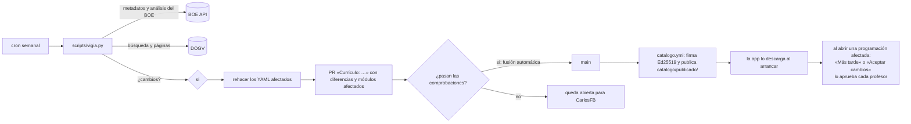

# Catálogo y fuentes oficiales

Cómo se construye y cómo se mantiene al día el catálogo curricular. Estructura de los archivos: [MODELO_DE_DATOS.md](MODELO_DE_DATOS.md). Decisiones: ADR-005 y ADR-015 (cada profesor aprueba los cambios).

## 1. Fuentes de cada dato

| Dato | Fuente | Cómo se lee |
| --- | --- | --- |
| Ciclos del centro | Web Pedidos en producción (API pública de `dotacion_material`, `get_cursos` con `etapa_id=5` y `grado=GM/GS`) | Una sola vez: ADR-003. Consultado el 2026-10-14 |
| Módulos de cada ciclo, curso, h/semana y h/año | Decreto 114/2025, anexos I (GM) y II (GS), DOGV núm. 10165 | Una vez y vigilado. La copia y su nota gemela están en `05 RECURSOS/LEGISLACIÓN/2025 FP/` de la bóveda |
| RA, criterios, competencias, competencia general y correspondencias (anexo V B) de los módulos propios | Real decreto de cada título, en su texto consolidado | API de datos abiertos del BOE: `/datosabiertos/api/legislacion-consolidada/id/<BOE-A-…>/…`. Lector de partida: `curriculo.py boe` de la skill `apuntes-auditoria` |
| UC → ECP | RD 532/2025 (BOE-A-2025-13147): mismo código numérico | Regla fija |
| RA de los módulos comunes (Inglés, Empleabilidad, Digitalización, Sostenibilidad) y de los optativos | Anexos del Decreto 114/2025 y normas de 2024 que crearon esos módulos | PDF del DOGV (sin API): extracción asistida y revisión humana |
| RA del Proyecto intermodular de GM (`1713xxx`) | **Pendiente de localizar** | — |
| Normativa general y autonómica | BOE y DOGV, con los enlaces ya verificados en `LEGISLACIÓN — Índice` de la bóveda | A mano, vigilado |
| Resolución de instrucciones de FP de cada curso | DOGV, cada julio | Aviso del vigía en julio y alta a mano |
| Fechas de evaluación y periodos de empresa | Calendario escolar FP y calendario de FE del centro (notas de la bóveda en `02 CURSOS ESCOLARES/<curso>/`) | A mano, una vez por curso |
| Optativos que oferta el centro | Programaciones de SEA, STI y ARI (2.2): 0179 (confirmado por CarlosFB el 2026-10-14), CVOPS031 y CVOPS141. El resto de ciclos los dará CarlosFB | A mano |

**Regla:** si un dato no está en la fuente, no se pone. Se deja la marca `pendiente: true` y la app lo enseña como «sin dato» y bloquea la definitiva de ese módulo.

## 2. Vigía (`.github/workflows/vigia.yml`)

- **Base:** `vigilancia.py` de la skill `apuntes-auditoria`, que ya guarda el estado conocido de cada norma, detecta cambios en el texto consolidado y acepta revisiones con `--aceptar`.
- **Qué compara:**
  - BOE: la fecha de actualización del consolidado y las normas que lo modifican.
  - DOGV: la página o el PDF de las normas vigiladas, por su huella.
- **Cuando hay un cambio,** la PR lleva tres cosas:
  - Qué norma ha cambiado y su enlace.
  - Las diferencias legibles («RA3 de 0517: criterio *g* nuevo…»).
  - El texto de novedades que verá el profesor.
- **En julio** abre además una incidencia: «Dar de alta el curso AAAA-AAAA: resolución de instrucciones, fechas, FE».
- **Si una fuente no responde,** la ejecución falla con aviso y no toca el catálogo.

## 3. Publicación y firma

- La clave privada Ed25519 está solo en un secreto del repositorio (`CATALOGO_CLAVE`). La pública va dentro de la app.
- `indice.json` contiene la versión (`AAAA.MM.DD[.n]`), la fecha, la huella SHA-256 del catálogo, la firma y las novedades en Markdown, por módulo afectado.
- La app solo acepta un catálogo con la firma válida y una versión mayor que la que tiene. Si algo falla, sigue con el anterior y lo apunta en el registro.

## 4. Construcción inicial

Orden propuesto (fase F1 de [HOJA_DE_RUTA.md](HOJA_DE_RUTA.md)):
1. Los 11 ciclos, con sus módulos y horas, a partir de la nota «PROGRAMACIONES — Ciclos y módulos» de la bóveda.
2. SEA, STI y ARI completos. Hay programaciones con las que contrastar: 0517, 0524, 0525, 0526, 0962 y 0963.
3. El resto de ciclos de la familia: IEA e IT.
4. Las otras familias: ADM, GA, ISO, AUT, CAR y EMV.
5. Los módulos comunes y los optativos.

Cada ciclo se cierra con `scripts/catalogo.py comprobar`: esquema, horas que suman 30 h/semana por curso, todos los módulos con RA y enlaces vivos.
